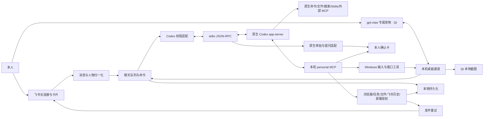

# 架构与维护边界

## 装配关系

只有 `src/main.ts` 装配全部组件。业务服务不引用 Codex 协议；换运行时主要修改 `src/codex/` 与装配点。当前聊天层依赖具体运行时接口，尚未提供第二种内核。

| 模块 | 职责 |
|---|---|
| `config.ts` | 环境参数及范围校验；不解读 Codex TOML |
| `feishu/device-auth.ts` | 终端 device 引导、项目 CLI 身份核对、写回凭证 |
| `feishu/channel.ts` | 机器人连接、本人过滤、CardKit 回复与回退、上传、回调 |
| `feishu/stream.ts / reply-card.ts / prompt-card.ts` | 序列化流式更新、正文与指标、独立权限卡的展示 |
| `feishu/normalizer.ts` 等 | 实时/引用/历史共用内容和人物解析 |
| `codex/rpc.ts` | 进程生命周期、协议行、双向请求、断开处理 |
| `codex/runtime.ts` | 原生配置检查、线程恢复、轮次、流式、中断、追加指令 |
| `codex/approvals.ts` | 将原生请求转成确认/补充信息；不自行解释 Shell |
| `app/prompts.ts` | 本人校验、请求编号、超时、取消；按会话区分前台与后台 |
| `app/application.ts` | 收件去重、按聊天归一化/执行队列、快捷命令 |
| `app/outbox.ts` | 收件完成与最终回复入队使用同一事务；保留卡片实体与序号，桌面回复保存确认后出队，失败重试 |
| `desktop/gateway.ts` | 本机认证连接、输入与卡片、共享开关、请求关联的截图往返 |
| `desktop/` | Qt 本地界面、动画、语音、截图；不创建模型会话 |
| `services/` | 浏览器、后台任务、日程、文件会话及前台屏幕授权 |
| `tools/` 源码层 | 工具契约、加载、标准 MCP 暴露、输入验证与业务确认 |
| `storage.ts` | SQLite 事务与持久化，不执行模型调用 |

## 三种权限边界

1. **入口身份**：本人 `open_id` 固定；群消息必须提及机器人。他人的群发言可以成为历史或引用内容，不能成为操作确认者。
2. **原生执行**：Codex 自己解释命令、执行文件工具并决定何时请求权限；客户端返回一次允许、拒绝或本轮权限，取消/超时不授权。复合命令、管道、重定向不由本工程穷举匹配。
3. **业务工具**：TS Tool 是可信本地代码；MCP 服务使用会话对应的随机 capability URL 绑定当前聊天。参数经过 Zod 严格校验；有副作用的内置操作请求本人确认。电脑工具以桌宠的“共享屏幕”开关授权当前请求的操作，不再逐次弹卡片。该服务的浏览器/飞书网络访问与电脑输入不继承 Codex 沙箱。

内置 MCP 绑定 loopback 随机端口，使用官方 MCP SDK 的 stateless Streamable HTTP。没有重写 MCP 协议；外部 MCP 由 Codex 原生客户端加载。URL 不写日志，但能力凭证仍可能出现在本机原生会话配置记录中，属于本人电脑信任范围。

本人身份由入口校验，模型不负责认证，也不在普通聊天中重复确认身份或申请身份权限。飞书普通输入仅在能得到可读姓名时附姓名，读不到就直接使用原文；不把本人 open_id 作为每条消息的前缀。追加指令直接交给原生 steer，不再重复本人 ID。真实引用、转发、历史记录和 @ 人物仍按实际需要保留人物标识；实际附件路径随消息提供，只有保存附件时才创建消息资源目录。

2026-10-19 起，会话文件目录与屏幕共享说明不再每轮拼入用户正文。模型通过只读 `personal.session_info` 按需取得当前入口、会话/产物目录和本轮电脑可用状态；普通闲聊不调用，创建文件时再查询。查询与电脑动作共用 `ScreenShare.authorizedGrant` 校验当前连接、聊天、轮次和取消信号，查询本身不启动截图或输入监听，也不授予操作权限。真正执行仍重新检查，并保持原观察引用、目标窗口、取消与冲突控制。

此调整只影响新输入，不重写已有 Codex 会话记录。服务运行信息在按需调用后仍作为工具结果进入原生历史；没有承诺完全不记录上下文或零额外 token。原生执行权限、业务确认和共享屏幕开关仍按各自配置处理。修改 `AGENTS.md` 后重启服务并使用 `/new` 开新会话，以确保新使用规则加载；没有删除旧对话。

## 专属桌宠与电脑操作

`services/screen-share.ts` 保存不持久化的共享授权：同时绑定桌面聊天、当前 UI 连接和桌宠进程。输入到达时记录授权 ID，前台模型轮次开始时再次校验；关闭后重新开启也不会授权旧消息。当前轮次以独立 ID 与取消信号绑定，飞书和后台会话不能调用电脑工具。开关仅改变授权，不调用模型或启动心跳；执行仍由已有 Codex 会话负责。

`tools/computer.ts` 使用 dsh-orb 的 Win32/Koffi 层识别窗口及发送输入，`tools/vendor/dsh-orb/` 保留 MIT 许可。截图通过桌面通道请求 Qt 界面提供；MCP Host 支持原生 `image` 内容块，Codex 直接看到截图。未移植 Cordis、Electron、DeepSeek Harness 或另一套模型循环。

`src/services/windows-mcp.ts` 按需连接内部只读 MCP 子进程。`integrations/windows-mcp/observer.py` 使用固定版本 Windows-MCP 的控件采集实现，只读取宿主传入并经 HWND/PID 校验的窗口，返回结构化数据。上游原生 Snapshot 以文本树为输出，不能直接提供本项目需要的元素契约，因此使用这层小适配，不复制采集实现。`personal.computer.observe` 提供 semantic/hybrid/screenshot 三种模式；元素引用只属于当前观察，操作前重新核对名称、类型、窗口和边界，再通过现有鼠标输入执行。不是 UIA 原生 Invoke。`wait_for` 在同一授权范围内做有界轮询，超时不自动重放动作。安装、限制和验证记录见 [混合桌面实施方案](computer-integration.md)。

浏览器入队时绑定取消信号，出队及关键执行点再次检查。执行中的取消关闭本次操作页以打断 Playwright 等待；远端已经收到的提交无法回滚。各会话拥有自己的标签页，但共享同一个个人浏览器的登录状态。

首次电脑工具调用会经桌面协议发送 `screen.control.state`，直到本轮结束或授权撤销。桌宠的 `input_monitor.py` 在该期间用独立 hook 线程观察真实输入，忽略注入事件；接管后关闭共享并请求取消，不自动恢复。监视不记录按键内容，也不阻挡物理输入。`ScreenShare.withBrowser` 与电脑操作互斥，并在桌面任务已活跃时拒绝其他会话争用浏览器；同会话浏览器合并当前桌面授权的取消信号。外部进程的桌面争用不属于这把进程内锁。

输入必须引用当前轮次最近的观察 ID。鼠标/键盘输入必须已有截图，并校验窗口进程、位置、遮挡和前台归属；截图过期或窗口变化时要求重新观察。共享电脑操作串行执行，拖动和快捷键在取消时释放已按下的鼠标/键盘。关闭共享、UI 断线、退出和取消以 AbortSignal 终止后续步骤，但无法撤回已完成的输入。Ctrl+Alt+Esc 在本地关闭共享并取消当前轮次。截图只覆盖选中的应用及其菜单/弹窗，不自动持续捕获整个桌面。

对外名称统一为“gpt-claw 专属宠物”或“桌宠”。现有 `minipet.v1`、`/ws/minipet`、应用及存储标识继续兼容旧连接、设置和聊天记录；这些内部名称不表示独立产品，也不触发数据迁移。

## 桌面回复状态

`desktop/src/reply_coordinator.py` 独立持有活动轮次、卡片与轮次的索引、断线代次及迟到回复的来源，不依赖 Qt、网络连接或消息存储。`TurnContext` 的文本只由 `TextStreamState` 保存，避免重复维护完整回复。

`desktop/src/app.py` 负责连接事件、计时器、界面回调、宠物任务状态和历史保存。轮次注销成功后才执行收尾，重复终态不会重复触发轮次回调。断线等待仍为 20 秒；恢复事件移除已恢复轮次，旧连接的超时回调不会结束新连接的轮次。终态回复仍先持久化，再确认投递。

## 状态与重启

- `data/` 是业务状态，Codex 完整对话由其原生存储保管。本工程保存线程 ID 映射，不复制完整模型历史。
- Codex 原生线程保存模型对话，同一聊天重启后按线程 ID 自动恢复；Agent 后端不再写独立的聊天或学习表，也不提供跨线程正文搜索。桌宠保存界面展示记录，不逐轮向模型重传完整展示历史；发件队列只临时保留投递文本。Codex 原生记忆已在工程配置启用，何时提炼由 Codex 控制。
- 收件记录临时保存原始事件并用消息 ID 去重；完成、失败或中断后清除事件内容。相同聊天按事件到达顺序完成归一化，再进入前台 FIFO；追加指令通过 `/steer` 明确走活动轮次。
- 桌面 `input.accepted` 表示输入已写入收件记录，不等待命令或模型执行完成。桌面连接客户端关联并消费接收确认；断线或 20 秒内未确认时提示接收结果不确定，不自动重发输入。
- 尚未执行的前台消息与 queued 后台任务在重启后恢复；已进入命令或模型执行的消息及 running 后台任务标记 interrupted，不自动重放可能产生过副作用的任务。
- 定时触发以一次 SQLite 事务写入 occurrence 对应的任务和下一次游标；错过多个周期只执行一次。
- 收件完成与最终回复入队使用同一 SQLite 事务，避免完成标记已写入而回复尚未入队时崩溃导致丢失结果。
- 后台任务的完成、失败及中断状态与通知入队使用同一 SQLite 事务；启动时恢复 running 任务也遵循此规则。通知交给现有发件队列定时投递，不在任务执行器内另设重试。
- 发件队列按退避间隔重试，同一投递阶段累计失败八次后标记失败并停止自动重试；飞书卡片转普通消息时重新计数。日志列出投递编号和手动重投命令。`/status` 按当前聊天统计投递状态，并列出最早 20 条失败记录的编号及失败次数；有更多记录时明确提示。查询不返回回复正文或错误原文；`/retry 编号` 只允许重投当前聊天的失败回复，不重跑模型任务。桌面最终文本使用稳定 `delivery_id`；新版桌宠先保存成功回复、记录本地收据，再通过 `surface.ack` 确认，重投时按 ID 去重。未连接、旧界面不支持确认或 12 秒内没有确认时，回复保留待重试；流式进度、附件和语音不在这份保存确认范围内。飞书仍可能在远端成功、本地未拿到确认时重复投递，不承诺 exactly-once。
- 服务仍在运行且保留最终回复卡片时，桌宠重连会重放卡片；即使该条投递已超时或耗尽重试，迟到的保存确认仍会回写已发送状态。确认需匹配当前连接的会话、最终卡片和投递 ID；先持久化再移除卡片，旧重试结果不会将已确认记录改回失败，重复确认不延长正文保留期。服务重启后不会从内存恢复已耗尽重试的卡片，失败记录仍可手动重试。
- 发件成功时记录 `sent_at`，正文默认保留 7 天（`OUTBOX_SENT_RETENTION_DAYS`，1–365 天）。启动时及每小时清除到期已发送记录的正文、统计文字、投递参数与错误内容，保留投递标识和状态；待发送及失败记录不清理。升级前缺少成功时间的已发送记录从首次升级启动起算。清理不影响桌宠展示记录或 Codex 线程，详见 [保留期限](learning.md#已发送队列正文的保留期限)。
- 停止或超时后，模型轮次在收到完成事件或断线前保留活动占位；即使 `turn/start` 尚未返回 ID，也会在得知 ID 后补发中断。占位期间不接受新轮次、追加指令、重置或压缩，避免旧轮次未停就并发执行；中断不保证外部副作用回滚。若服务端始终不返回轮次状态，需要重连或重启恢复。
- 后台任务按状态和聊天使用 SQLite 条件与索引查询，列表最多取 30 条，调度只取可用并发数量，不再先加载全部任务到内存筛选。
- 退出先阻止入口与队列，取消确认和轮次，关闭原生进程，等待归一化/任务/工具收尾，再关闭存储、释放实例锁。Windows 原生 Codex 由 JS 启动器拉起，超时退出时清理其子进程树。
- 桌宠退出直接取消连接监听任务，包括重连退避等待；清理剩余协程并关闭事件循环后等待 QThread 结束。

## 保持简单的规则

- 不引入自研模型循环、Shell 白名单或模型审核器。
- 不自建记忆副本；不默认启动浏览器或安排本工程的主动模型调用。Codex 原生记忆可能在空闲时调用模型。
- 工具使用方法写在工具 description/Skill 中。`AGENTS.md` 只保留通用身份与行为约束。
- 必须稳定生效的长期规则写工程 `AGENTS.md`；普通偏好交由 Codex 原生记忆提炼。人物通讯录缓存不等于长期记忆。
- 业务新增先实现独立服务，再用小工具包装。只有需要跨项目复用或单独部署时才拆外部 MCP。
- 版本升级先核对官方协议及目标 CLI 的生成 schema，避免用 `as any` 掩盖 SDK 返回值差异。

## 已知实现限制

尚未实现完整 SQLite schema 版本迁移/备份命令、会话与附件保留策略、空闲原生线程卸载、工具执行审计面板。Codex 崩溃后会在下一次任务中重连，当前运行中的任务不会自动重放。MCP 取消不保证撤回已经进入浏览器/外部 API 的操作；业务任务也没有逐步骤恢复。当前优先级与完成标准见 [产品路线](roadmap.md)，桌面实现和实际验收证据见 [混合桌面实施方案](computer-integration.md)。
